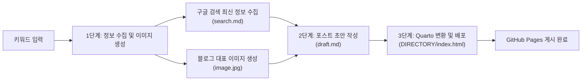

# PRD: AI 기반 블로그 자동화 시스템 (자료 수집 · 초안 작성 · Quarto & GitHub Pages 배포)

## 1. 프로젝트 개요 (Overview)
본 프로젝트는 사용자가 **키워드(주제)**만 입력하면 최신 자료 수집부터 대표 이미지 생성, 블로그 포스트 초안 작성, Quarto를 활용한 HTML 변환 및 GitHub Pages 게시까지 전 과정을 자동화하는 **End-to-End 블로그 포스트 자동화 파이프라인**을 구축하는 것을 목표로 합니다.

---

## 2. 목표 및 핵심 가치 (Objectives)
- **시간 단축**: 리서치, 시각 자료 제작, 초안 집필, 퍼블리싱에 소요되는 시간을 대폭 단축합니다.
- **최신성 및 정확성 확보**: 구글 검색을 통해 최신 정보를 수집하고 출처가 명시된 근거 기반의 글을 작성합니다.
- **표준화된 산출물 관리**: 각 단계별 산출물(`search.md`, `image.jpg`, `draft.md`, `DIRECTORY/index.html`)을 파일 단위로 명확하게 분리·보존하여 검수 및 재사용성을 높입니다.
- **자동 배포**: Quarto와 GitHub Pages를 연동하여 마크다운 문서를 웹 표준 HTML 블로그로 손쉽게 변환 및 배포합니다.

---

## 3. 전체 워크플로우 아키텍처 (Workflow Architecture)



---

## 4. 단계별 상세 기능 요구사항 (Functional Requirements)

### Step 1. 키워드 기반 정보 수집 및 에셋 생성
사용자가 지정한 타겟 키워드를 바탕으로 최신 텍스트 자료와 시각 에셋을 준비합니다.

1. **최신 정보 수집 (`search.md`)**
   - **동작**: 구글 검색(Web Search)을 활용하여 타겟 키워드와 관련된 최신 뉴스, 트렌드, 기술 문서, 통계 데이터를 수집합니다.
   - **산출물 포맷 (`search.md`)**:
     - 검색 키워드 및 수집 일시
     - 핵심 요약 (Executive Summary)
     - 주요 세부 내용 및 팩트 정리
     - 참고 자료 및 원본 출처 URL 목록
2. **블로그 이미지 생성 (`image.jpg`)**
   - **동작**: 수집된 정보의 핵심 주제를 시각적으로 표현하는 프롬프트를 구성하고, AI 이미지 생성 도구를 통해 고품질 썸네일/본문 이미지를 생성합니다.
   - **산출물 포맷 (`image.jpg`)**:
     - 포스트 디렉터리 내 `image.jpg`로 저장
     - 블로그 대표 썸네일 및 본문 상단 삽입용 규격(예: 16:9 또는 1:1 비율) 준수

---

### Step 2. 블로그 포스트 초안 작성 (`draft.md`)
1단계에서 생성된 `search.md`와 `image.jpg`를 결합하여 완성도 높은 블로그 아티클 초안을 작성합니다.

1. **초안 작성 규칙**
   - **Quarto YAML 프론트매터 포함**: 제목(`title`), 작성일(`date`), 카테고리(`categories`), 요약(`description`), 대표 이미지(`image: image.jpg`) 메타데이터를 상단에 정의합니다.
   - **구조화된 본문 구성**:
     - **도입부(Intro)**: 독자의 흥미를 유발하는 배경 설명 및 문제 제기
     - **대표 이미지 삽입**: `` 형태로 자연스럽게 배치
     - **본론(Body)**: 소제목(`##`, `###`), 글머리 기호, 표, 코드 블록 등을 활용한 가독성 높은 설명
     - **결론(Outro)**: 핵심 요약 및 향후 전망/인사이트 제시
     - **참고문헌(References)**: `search.md`에서 수집한 출처 링크 명시
2. **산출물 포맷 (`draft.md`)**
   - 마크다운 문법과 Quarto 렌더링 규격을 준수한 `draft.md` 파일 생성

---

### Step 3. Quarto HTML 변환 및 GitHub Pages 포스팅 (`DIRECTORY/index.html`)
작성된 마크다운 초안을 정적 웹페이지로 변환하고 GitHub Pages에 게시합니다.

1. **Quarto 기반 HTML 렌더링**
   - 포스트 전용 디렉터리(`DIRECTORY/`) 내에 초안과 이미지 에셋을 배치합니다.
   - Quarto CLI(`quarto render`)를 실행하여 `draft.md`(또는 `DIRECTORY/index.qmd`)를 `DIRECTORY/index.html`로 변환합니다.
   - 코드 하이라이팅, 반응형 레이아웃, 목차(TOC), 메타태그가 적용된 HTML 결과물을 생성합니다.
2. **GitHub Pages 배포**
   - 렌더링된 정적 파일(`DIRECTORY/index.html` 및 관련 에셋)을 Git 저장소에 스테이징 및 커밋합니다.
   - `git push` 또는 `quarto publish gh-pages` 명령을 통해 원격 GitHub 저장소(`main` 또는 `gh-pages` 브랜치 / `docs/` 폴더)에 자동 배포합니다.

---

## 5. 디렉터리 및 파일 구조 (Directory Structure)

```text
antigravity_blog/
├── PRD.md                      # 프로젝트 요구사항 정의서
├── _quarto.yml                 # Quarto 블로그 전역 설정 파일
├── index.qmd                   # 블로그 메인 랜딩 페이지
└── <DIRECTORY>/                # 개별 포스트 디렉터리 (예: posts/2026-10-30-topic/)
    ├── search.md               # [Step 1] 구글 검색 기반 최신 정보 수집 결과
    ├── image.jpg               # [Step 1] 생성된 블로그용 대표 이미지
    ├── draft.md                # [Step 2] 작성된 블로그 포스트 초안
    └── index.html              # [Step 3] Quarto로 변환된 최종 HTML 파일
```
*(※ GitHub Pages 배포 설정에 따라 최종 빌드 산출물은 루트의 `<DIRECTORY>/index.html` 또는 `docs/<DIRECTORY>/index.html` 경로에 생성되어 서빙됩니다.)*

---

## 6. 기술 스택 및 활용 도구 (Tech Stack)

| 구분 | 활용 기술 / 도구 | 역할 |
| :--- | :--- | :--- |
| **정보 수집** | Google Search (Web Search Tool) | 키워드 관련 최신 정보, 아티클 및 출처 URL 수집 |
| **이미지 생성** | AI Image Generator | 주제에 부합하는 대표 이미지(`image.jpg`) 생성 |
| **초안 작성** | AI Agent (LLM) | `search.md` 기반 마크다운 포스트(`draft.md`) 작성 |
| **문서 변환** | Quarto CLI | 마크다운 문서를 반응형 HTML(`index.html`)로 렌더링 |
| **호스팅/배포** | Git & GitHub Pages | 변환된 HTML 및 에셋 버전 관리, 정적 웹사이트 퍼블리싱 |

---

## 7. 완료 조건 및 검증 기준 (Acceptance Criteria)
1. **Step 1 검증**: 지정된 키워드로 최신 정보가 요약되고 출처 링크가 포함된 `search.md`와 시각 이미지 파일 `image.jpg`가 정상 생성되었는가?
2. **Step 2 검증**: `search.md`의 팩트를 반영하고 `image.jpg`가 연결된 블로그 초안 `draft.md`가 YAML 프론트매터와 함께 작성되었는가?
3. **Step 3 검증**: Quarto를 통해 오류 없이 `DIRECTORY/index.html`이 생성되었으며, GitHub Pages에 정상 푸시되어 웹 브라우저로 접속 가능한가?

