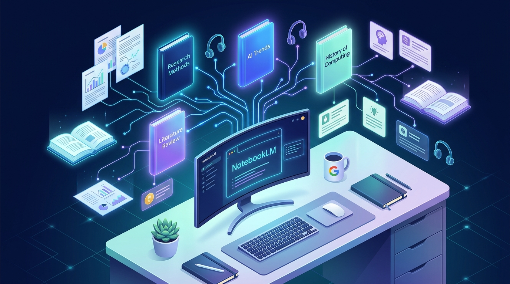
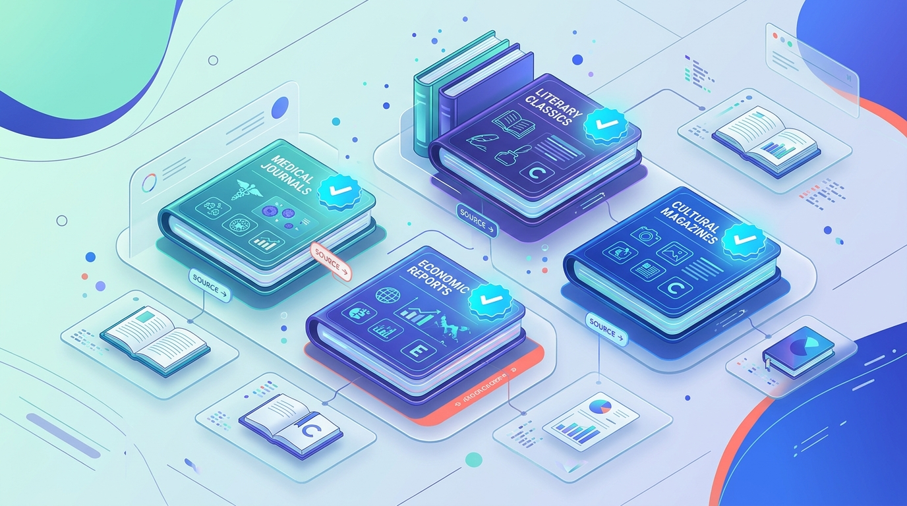
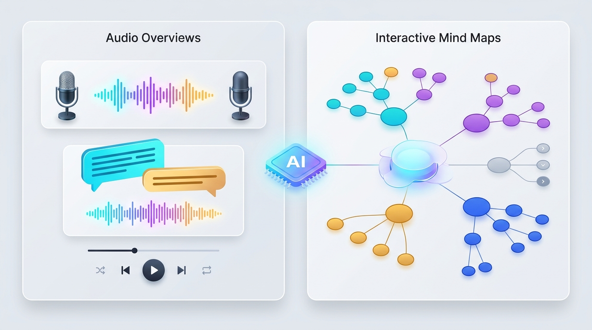

## 1. 도입: AI 리서치 도구, 첫걸음부터 막막하셨나요?

**"성능 좋은 AI 노트 도구가 있다는 건 알겠는데, 정작 어떤 자료를 넣어서 어떻게 써야 할지 모르겠어요."**

혹시 구글의 AI 기반 리서치 어시스턴트인 **NotebookLM**을 처음 열었을 때, 텅 빈 소스 업로드 창 앞에서 이런 고민을 해본 적이 있으신가요? 좋은 답변을 얻으려면 먼저 신뢰할 수 있는 PDF, 논문, 웹 문서들을 직접 찾아 정리해야 한다는 점은 많은 사용자에게 보이지 않는 진입 장벽이었습니다.

만약 세계적인 언론사, 베스트셀러 저자, 석학들이 **이미 엄선해 둔 최고 품질의 자료집**이 눈앞에 준비되어 있고, 클릭 한 번으로 그 지식과 대화하거나 AI 팟캐스트로 들을 수 있다면 어떨까요? 구글이 새롭게 선보인 **'Featured Notebooks(특집/추천 노트북)'**가 바로 그 상상을 현실로 만들었습니다.

---

## 2. 핵심 요약: Featured Notebooks의 3가지 핵심 가치

바쁜 독자분들을 위해 **Featured Notebooks**가 제공하는 가장 중요한 변화 3가지를 먼저 정리해 드립니다.

1. **전문가·글로벌 기관의 사전 큐레이션 (Expert-Curated Sources)**
   사용자가 직접 문서를 수집할 필요 없이, *The Economist*, *The Atlantic*, 저명한 연구자 및 작가가 직접 선별·검증한 고품질 소스 컬렉션을 즉시 탐색할 수 있습니다.
2. **멀티모달 AI 도구의 즉각적인 경험 (Pre-Built Multimodal AI Tools)**
   AI 호스트가 대화하듯 주제를 설명해 주는 **오디오 오버뷰(Audio Overviews)**, 복잡한 개념을 시각화한 **인터랙티브 마인드맵(Mind Maps)**, 그리고 정확한 출처 인용(Citation) 기반의 **심층 질의응답(Q&A)**이 미리 준비되어 있습니다.
3. **안전한 탐색 환경과 지식 공유 생태계 확장 (Read-Only & Public Sharing)**
   원본 소스를 훼손할 걱정 없는 읽기 전용(Read-Only) 학습 환경을 제공하며, 누구나 자신의 노트북을 공유할 수 있는 공개 공유(Public Sharing) 생태계와 맞물려 지식 소비의 방식을 혁신합니다.

---

## 3. 상세 설명: 구체적인 예시로 살펴보는 Featured Notebooks

### ① 세계적인 전문가와 미디어가 직접 만든 지식 컬렉션

기존의 AI 검색이 인터넷의 무분별한 정보를 긁어와 답변했다면, Featured Notebooks는 **'누가 검증한 자료인가'**에 집중합니다. 구글은 각 분야의 권위자 및 미디어 파트너와 협력하여 깊이 있는 주제별 노트북을 구축했습니다.

- **글로벌 경제 및 국제 정세**: 영국 시사 주간지 *The Economist(이코노미스트)*의 연례 특별 보고서인 **"The World Ahead"** 노트북을 열면, 올해의 세계 경제 전망과 지정학적 이슈를 담은 방대한 리포트를 한눈에 분석할 수 있습니다.
- **건강과 장수 과학**: 세계적인 의학 연구자 에릭 토폴(Eric Topol) 박사의 저서 **"Super Agers(슈퍼 에이저)"** 노트북에서는 건강한 노화와 최신 의학 연구 데이터를 직접 질문하며 탐색할 수 있습니다.
- **인문·교양 및 라이프스타일**: *The Atlantic(애틀랜틱)*의 칼럼니스트 아서 브룩스(Arthur C. Brooks)가 집필한 **"How to Build a Life(삶을 가꾸는 법)"** 칼럼 모음부터 **윌리엄 셰익스피어 전집**, **옐로스톤 국립공원 생태·지질 가이드**에 이르기까지 학술과 일상을 아우르는 다채로운 컬렉션이 제공됩니다.

가장 큰 장점은 **출처 기반 인용(Grounded Citations)**입니다. 사용자가 채팅창에 질문을 던지면, AI는 임의로 지어낸 말이 아니라 해당 전문가가 작성한 원문의 정확한 문단과 출처를 번호로 매겨 함께 보여줍니다.

---

### ② 듣는 팟캐스트부터 보는 마인드맵까지, 사전 생성된 AI 분석 도구

Featured Notebooks에 접속하면 수십 개의 원문 파일을 일일이 읽지 않아도 입체적인 학습이 가능하도록 **사전 생성된 AI 아티팩트(Pre-Built Artifacts)**가 즉시 제공됩니다.

- **오디오 오버뷰 (Audio Overviews)**: 버튼 하나만 누르면 두 명의 AI 호스트가 등장해 노트북의 핵심 주제를 주고받으며 흥미진진한 팟캐스트 형식으로 풀어냅니다. 예를 들어 출퇴근길에 *The Economist*의 글로벌 경제 전망을 라디오처럼 들으며 핵심을 파악할 수 있습니다.
- **인터랙티브 마인드맵 (Mind Maps)**: 방대한 자료 속 핵심 키워드와 하위 개념들이 어떻게 연결되는지 시각적인 트리 구조로 보여줍니다. 궁금한 노드를 클릭하면 해당 개념에 대한 세부 설명과 원문 근거로 바로 이동합니다.
- **맞춤형 대화 및 추천 질문**: 처음 접하는 분야라도 당황할 필요가 없습니다. 노트북마다 사전 구성된 브리핑 문서, FAQ, 타임라인과 추천 질문이 제공되어 클릭만으로도 깊이 있는 탐구를 시작할 수 있습니다.

---

### ③ 읽기 전용 안전망과 14만 개를 돌파한 지식 공유 생태계

Featured Notebooks는 누구나 안심하고 실험해 볼 수 있도록 **읽기 전용(Read-Only) 환경**으로 설계되었습니다. 사용자가 실수로 원본 소스를 삭제하거나 구성을 망가뜨릴 염려가 없으며, 그 안에서 자유롭게 질문하고 아이디어를 얻을 수 있습니다.

또한 이 기능은 NotebookLM의 **공개 공유(Public Sharing)** 기능과 강력한 시너지를 내고 있습니다.
- 사용자는 공식 Featured Notebooks를 통해 **"좋은 노트북이란 어떻게 구성되는가"**에 대한 모범 사례(Best Practice)를 자연스럽게 배울 수 있습니다.
- 이후 자신이 직접 모은 자료로 나만의 노트북을 만들고 `링크가 있는 모든 사용자(Anyone with a link)` 설정을 통해 동료, 학생, 커뮤니티에 손쉽게 공유할 수 있습니다. 실제로 공개 공유 기능 출시 한 달 만에 전 세계 사용자들이 만든 공개 노트북이 **14만 개**를 넘어설 만큼 폭발적인 호응을 얻고 있습니다.

---

## 4. 마무리: '읽는 책'에서 '대화하는 지식'으로의 패러다임 전환

구글 NotebookLM의 **Featured Notebooks**는 단순한 기능 업데이트를 넘어, 우리가 정보를 소비하고 지식을 유통하는 방식에 중요한 이정표를 제시합니다.

과거에는 저자가 책을 쓰거나 기관이 보고서를 발행하면 독자는 처음부터 끝까지 정해진 순서대로 읽어야 하는 **단방향 소비**에 머물렀습니다. 하지만 이제는 독자가 자신의 수준과 관심사에 맞춰 저자의 자료집에 직접 질문을 던지고, 오디오로 듣고, 마인드맵으로 구조를 파악하는 **'양방향 인터랙티브 지식 미디어'** 시대가 열렸습니다.

앞으로 대학 강의실의 교재, 기업의 기술 백서, 공공기관의 정책 보고서들이 단순한 PDF 파일 대신 **'큐레이션된 AI 노트북'** 형태로 배포되는 풍경이 일상화될 것입니다. 지금 바로 [NotebookLM 공식 웹사이트](https://notebooklm.google.com)의 Featured Notebooks 탭을 열어, 세계적인 전문가들이 준비해 둔 지식의 바다와 대화를 시작해 보시는 건 어떨까요?

---

## 참고 자료 (References)

- Google Official Blog (The Keyword): <https://blog.google/technology/google-labs/notebooklm-featured-notebooks/>
- Google AI Blog: <https://blog.google/technology/ai/notebooklm-featured-notebooks/>
- Thurrott 기술 분석 리포트: <https://thurrott.com/cloud/google/google-workspace/313366/google-brings-featured-notebooks-to-notebooklm>
- Google NotebookLM 고객센터 도움말: <https://support.google.com/notebooklm/answer/15239327>
- Google NotebookLM 공식 사이트: <https://notebooklm.google.com>

